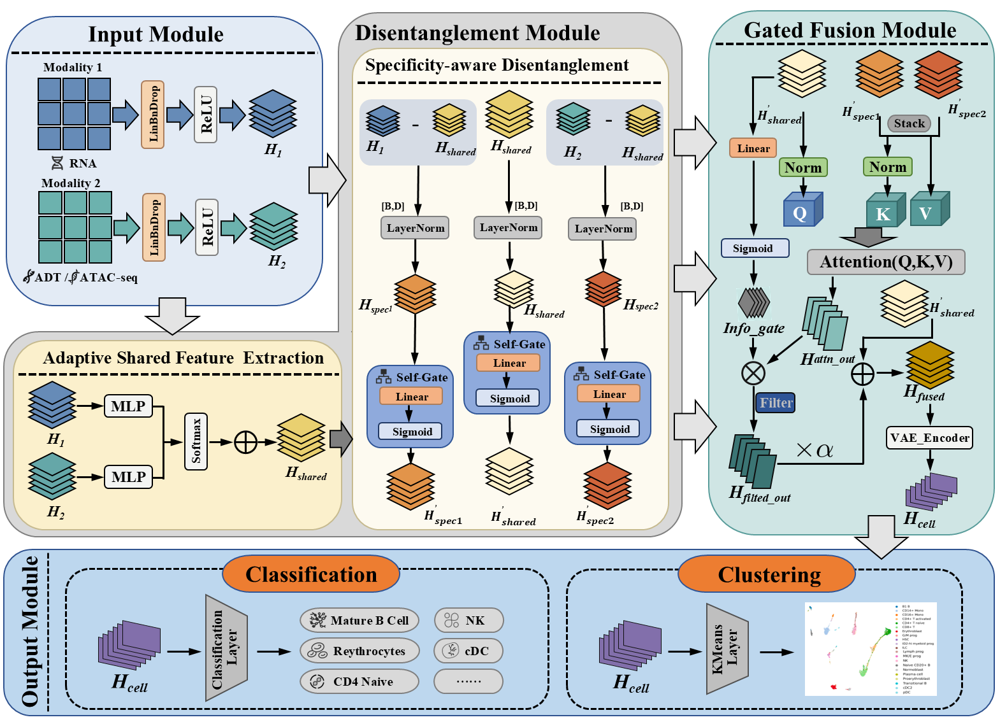

<div align="center">

# scMoDCA

### A Disentangled Cross-Attention Network for Single-Cell Multimodal Representation Learning

Kaiwen Tan · Gaoyuan Yang · Xuyang Zhao · Jie Feng · Yongbing Zhang · Zhenqiu Shu · Yun Bai

Faculty of Information Engineering and Automation, Kunming University of Science and Technology

**Mutual-information-constrained disentanglement · Adaptive gated fusion**

[Overview](#overview) · [Framework](#framework) · [Installation](#installation) · [Datasets](#datasets) · [Quick start](#quick-start) · [Evaluation](#evaluation)

</div>

## Overview

**scMoDCA** learns cellular representations from paired single-cell multimodal data, including **RNA–ATAC** and **RNA–ADT** measurements. It separates modality-shared and modality-specific information, reduces redundant dependencies through mutual-information objectives, and adaptively incorporates complementary information through gated cross-attention.

The framework is evaluated on eight paired datasets using cell-type classification and assessment of cell-type structure in held-out representations. Additional analyses examine representation dependence, fusion strategies, frozen-model branch interventions, biological attribution, and batch-associated structure.

## Framework

<p align="center">
  
</p>

### Mutual-information-constrained disentanglement

Two modality encoders project the input measurements into a common hidden space. A cell-wise gate estimates a shared representation, and residual decomposition extracts modality-specific representations.

- **Basic CLUB constraints** reduce dependence between shared and modality-specific branches.
- **Conditional mutual-information constraints** reduce redundancy between modality-specific branches while accounting for the shared representation.
- **InfoNCE-based information preservation** retains information shared between the modality encodings and the shared representation.

### Adaptive gated fusion

The shared representation supplies the query for cross-attention over the modality-specific branches. A learnable gate regulates the complementary contribution, which is incorporated through residual fusion to obtain the final cellular representation.

The model is trained jointly with reconstruction and cell-type classification objectives. Its representations are therefore **label-informed**.

## Repository structure

```text
.
├── docs/images/scmodca_framework.png   # Model overview
├── data/                              # Paired AnnData inputs
├── scMoDCA_final/
│   ├── run_main_experiment.py          # Main five-fold experiment
│   ├── model_original.py              # Preserved base model
│   ├── config_original.py             # Base configuration
│   ├── architecture.py                # Model construction
│   ├── representation.py              # Representation variants
│   ├── data_loading.py                # Data loading and preprocessing
│   └── run.py                         # Dataset settings and separate staged workflow
├── experiments/
│   ├── run_experiments.py             # Shared utilities and dataset paths
│   ├── training.py                    # Training utilities
│   └── metrics.py                     # Evaluation metrics
├── model/                             # Original model implementation
├── config.py                          # Configuration used by shared utilities
└── experiment_outputs/                # Generated results
```

Keep this structure intact: the main experiment imports modules from both `scMoDCA_final/` and `experiments/`, and shared utilities also reference `model/` and `config.py`.

## Installation

Use an isolated Python environment. The commands below provide a starting setup, not a locked reproduction environment.

```bash
conda create -n scmodca python=3.10 -y
conda activate scmodca

pip install torch
pip install numpy pandas scipy scikit-learn scanpy anndata h5py
pip install episcanpy scikit-misc ezdict matplotlib seaborn umap-learn tqdm
```

For GPU training, install a PyTorch build compatible with your CUDA environment. A CUDA-capable GPU is recommended for large datasets.

## Datasets

Inputs are paired `.h5ad` files. Cells must have corresponding identifiers in `obs_names`, and cell-type annotations must be available in `obs` for supervised training and evaluation.

| Dataset | Modalities | Directory used by the current code |
|---|---|---|
| SNARE | RNA + ATAC | `data/SNARE/` |
| CITE | RNA + ADT | `data/CITE/` |
| PBMC | RNA + ATAC | `data/PBMC/` |
| SHARE | RNA + ATAC | `data/SHARE/` |
| BMMC | RNA + ATAC | `data/NeurIPS_BMMC/` |
| GSE | RNA + ADT | `data/GSE128639_CITE/` |
| SLN111 | RNA + ADT | `data/spleen_lymph_CITE_111/` |
| SLN208 | RNA + ADT | See naming note below |

**Naming note:** the manuscript uses `SLN208`, whereas the current implementation retains the legacy key and directory `spleen_lymph_CITE_206`. Verify the underlying files before running; changing a display name alone does not establish dataset identity.

Example layout:

```text
data/
├── SNARE/
│   ├── RNA.h5ad
│   └── ATAC.h5ad
├── PBMC/
│   ├── RNA.h5ad
│   └── ATAC.h5ad
└── CITE/
    ├── RNA.h5ad
    └── ADT.h5ad
```

Paths are defined in `experiments/run_experiments.py`. Dataset-specific labels are configured in `DATASET_CONFIG` in `scMoDCA_final/run.py`; the current CITE label key is `celltype.l2`.

The main entry point currently passes `all_batches=False` to the loader; for CITE, this selects donor `P2`. Check batch selection and filtering settings when matching a particular manuscript experiment.

## Quick start

Run commands from the repository root.

```bash
python scMoDCA_final/run_main_experiment.py
```

This entry point uses configuration constants rather than command-line arguments. By default, it runs five folds for the configured datasets, excluding `10X10k_CITE`, and resumes completed folds.

For an initial SNARE experiment, edit the configuration block in `scMoDCA_final/run_main_experiment.py`:

```python
RUN_DATASETS = ["SNARE"]
SEED = 1024
FOLDS = 5
EPOCHS = 30
BATCH_SIZE = 128
LEARNING_RATE = 1e-4
N_FEATURES = 4000
```

Then run the same command. Use a new `OUTPUT_ROOT` when changing experimental settings to avoid reusing cached results from a different configuration.

`scMoDCA_final/run.py` launches a separate staged workflow; use `run_main_experiment.py` for the main experiment described here.

### Outputs

Results are written by default to:

```text
experiment_outputs/final_model/main_original_fused_recon_v11/
```

The directory contains per-fold results, training histories, and aggregate files:

- `main_experiment_fold_results.csv`
- `main_experiment_mean_std_variance.csv`
- `main_experiment_paper_table.csv`

## Evaluation

| Evaluation | Metrics | Interpretation |
|---|---|---|
| Cell-type classification | ACC, Macro-F1 | Agreement between classifier predictions and annotated cell types |
| Cell-type structure | NMI, ARI | Agreement between K-means partitions and annotated cell types |
| Representation dependence | nHSIC | Relative dependence between representation branches |
| Geometric branch separation | Silhouette, Calinski–Harabasz | Geometric separation of shared and modality-specific representations |

The main experiment uses five-fold stratified cross-validation with seed `1024`. K-means uses `30` initializations, with the number of clusters set to the number of annotated cell types.

Because labels contribute to model training, NMI and ARI characterize a **supervised representation**, rather than a fully unsupervised clustering benchmark. In the current main entry point, classification predictions come from the trained classification head.

## Additional analyses

Scripts under `scMoDCA_final/` and `experiments/` support ablation, attention analysis, MI validation, batch robustness, and PBMC biological interpretation. These directories also contain exploratory variants with different configurations. Read each script's settings and output paths before using it to reproduce a specific manuscript experiment.

## Contact

For questions about the manuscript, contact **Yun Bai** at **baiyun@stu.kust.edu.cn**.

## Acknowledgements

This work was supported by the National Natural Science Foundation of China under Grant 62302201, the Major Science and Technology Special Projects of Yunnan Province under Grant Nos. 202502AS080003 and 202402AG050007, and the Yunnan Xingdian Talent Support Plan Project.

The repository retains code and utilities from the scMoMtF-based development workflow. The previous repository description is preserved in [docs/README.scMoMtF.original.md](docs/README.scMoMtF.original.md).


